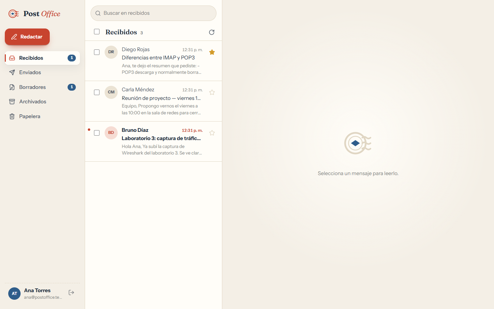

# Post Office API

Servidor de correo electrónico completo para el proyecto de **Redes de Computadores**: un MTA real
(Postfix), un servidor IMAP real (Dovecot) y una API REST en Python que actúa como cliente de esos
protocolos para el frontend web [Post Office](https://github.com/NastMz/Post-Office).



## Qué hace

- **Cuentas**: registro e inicio de sesión. Las contraseñas se guardan con bcrypt en el formato que
  Dovecot entiende (`{BLF-CRYPT}`), así que la misma cuenta sirve para la web y para un cliente de
  correo de escritorio.
- **Buzones IMAP**: Recibidos, Enviados, Borradores, Archivados y Papelera.
- **Mensajes**: redactar con varios destinatarios y CC, leer, responder (con `In-Reply-To` y
  `References`), marcar como leído/no leído, destacar, archivar, restaurar, enviar a la papelera y
  eliminar definitivamente.
- **Búsqueda** en el servidor con `UID SEARCH TEXT` de IMAP.
- **Borradores** guardados con `APPEND` en la carpeta `Drafts`; al enviarlos se conserva el hilo.
- **Datos de demostración**: cuatro cuentas y varias conversaciones enviadas por SMTP al arrancar.

## Requisitos

- Docker con Docker Compose v2.
- El frontend clonado al lado de este repositorio (`../Post-Office`) para levantar la interfaz web.
- Opcional, para desarrollo y pruebas: Python 3.12 o superior.

## Cómo ejecutarlo

```bash
git clone https://github.com/NastMz/Post-Office-API.git
git clone https://github.com/NastMz/Post-Office.git
cd Post-Office-API
docker compose up --build
```

| Servicio                | URL / puerto                  |
| ----------------------- | ----------------------------- |
| Cliente web             | http://localhost:8150         |
| API REST                | http://localhost:8151/api     |
| SMTP submission (587)   | `localhost:8152`              |
| IMAP (143)              | `localhost:8153`              |
| SMTP entre servidores (25) | `localhost:8154`           |

Cuentas de demostración (contraseña `postoffice`): `ana`, `bruno`, `carla` y `diego`
(`@postoffice.test`). Si el frontend está en otra ruta: `POSTOFFICE_WEB_PATH=/ruta/al/frontend docker compose up`.

Para parar y borrar los datos: `docker compose down -v`.

Los valores por defecto del `docker-compose.yml` son **solo para desarrollo**. Para cambiarlos,
copie `.env.example` a `.env`.

### Usar un cliente de correo real

Configure Thunderbird (u otro cliente) con usuario `ana@postoffice.test`, contraseña `postoffice`,
IMAP `localhost:8153` sin cifrado y SMTP `localhost:8152` sin cifrado con autenticación normal.
Verá las mismas carpetas y mensajes que en la web.

## Flujo de protocolos

```text
 Navegador ──HTTP/JSON──▶ API (Flask)
                           │  SMTP 587: EHLO → AUTH PLAIN → MAIL FROM → RCPT TO → DATA
                           ├──────────────────────────────▶ Postfix ──LMTP──▶ Dovecot ──▶ Maildir
                           │  IMAP 143: LOGIN → SELECT → UID SEARCH/FETCH/STORE/MOVE/APPEND
                           └──────────────────────────────▶ Dovecot
                                     Postfix y Dovecot consultan la tabla users de MariaDB
```

1. **Inicio de sesión.** La API verifica la contraseña contra el hash bcrypt y emite un JWT de
   8 horas que solo contiene la dirección del usuario. La versión original guardaba la contraseña
   en texto plano dentro del token; ya no.
2. **Acceso al buzón sin guardar contraseñas.** La API abre cada sesión IMAP/SMTP como
   `usuario@postoffice.test*api` con la contraseña del *master user* de Dovecot, que solo conoce
   el servidor. Dovecot autentica al usuario maestro y opera sobre el buzón del usuario indicado.
3. **Envío.** La API dirige el diálogo SMTP paso a paso. Postfix rechaza en `RCPT TO` a los
   destinatarios que no existen (`550 5.1.1 User unknown`) y la API devuelve un `422` con la lista
   exacta sin entregar nada. Postfix también impide suplantar remitentes
   (`reject_sender_login_mismatch`).
4. **Entrega.** Postfix entrega por LMTP a Dovecot, que guarda el mensaje en formato Maildir.
5. **Copia en Enviados.** Como cualquier cliente IMAP, la API guarda la copia enviada con `APPEND`
   en `Sent` con la bandera `\Seen`.
6. **Organización.** Las acciones usan banderas IMAP estándar (`\Seen`, `\Flagged`, `\Answered`,
   `\Draft`, `\Deleted`) y las extensiones `MOVE` (RFC 6851) y `UIDPLUS` (`UID EXPUNGE`,
   `APPENDUID`). Todos los identificadores son UID, no números de secuencia.

El laboratorio es una red cerrada: la entrega a dominios externos está desactivada y la API solo
acepta destinatarios `@postoffice.test`.

## API

Todas las rutas, excepto `auth/register`, `auth/login` y `health`, requieren
`Authorization: Bearer <token>`.

| Método   | Ruta                                       | Descripción                                    |
| -------- | ------------------------------------------ | ---------------------------------------------- |
| `POST`   | `/api/auth/register`                       | `{name, username, password}` → `201`           |
| `POST`   | `/api/auth/login`                          | `{email, password}` → `{token, user}`          |
| `GET`    | `/api/auth/me`                             | Usuario de la sesión                           |
| `GET`    | `/api/users`                               | Directorio para autocompletar destinatarios    |
| `GET`    | `/api/folders`                             | Totales y no leídos por carpeta (`STATUS`)     |
| `GET`    | `/api/folders/{folder}/messages`           | Lista paginada, `?q=&offset=&limit=`           |
| `GET`    | `/api/folders/{folder}/messages/{uid}`     | Mensaje completo                               |
| `PATCH`  | `/api/folders/{folder}/messages/{uid}`     | `{seen?, flagged?}`                            |
| `POST`   | `/api/folders/{folder}/messages/{uid}/move`| `{target: inbox \| archive \| trash}`          |
| `DELETE` | `/api/folders/{folder}/messages/{uid}`     | A la papelera; desde Papelera/Borradores, definitivo |
| `POST`   | `/api/messages`                            | Enviar `{to, cc, subject, body, reply_to?, draft_uid?}` |
| `POST`   | `/api/drafts`                              | Guardar o reemplazar un borrador               |
| `GET`    | `/api/health`                              | Estado y dominio de correo                     |

`folder` es uno de `inbox`, `sent`, `drafts`, `archive`, `trash`. Los errores siempre tienen la
misma forma:

```json
{ "error": { "code": "unknown_recipient", "message": "Some recipients do not exist",
             "details": [{ "field": "to", "value": "nadie@postoffice.test", "reason": "5.1.1 ..." }] } }
```

## Pruebas

```bash
py -3.13 -m venv .venv            # o python3 -m venv .venv
.venv/Scripts/pip install -r requirements-dev.txt   # .venv/bin/pip en Linux/macOS
.venv/Scripts/python -m pytest --cov               # 56 pruebas unitarias
.venv/Scripts/ruff check . && .venv/Scripts/ruff format --check .
```

Las pruebas unitarias no necesitan red: usan dobles en memoria del buzón IMAP, del transporte SMTP
y del repositorio de usuarios, y dobles con guion del protocolo para comprobar los comandos exactos
que se envían a Dovecot y Postfix. La prueba de integración usa la pila real:

```bash
docker compose up -d --build
.venv/Scripts/python -m pytest -m integration
```

## Arquitectura

```text
postoffice_api/
├── app.py              Fábrica de Flask e inyección de dependencias
├── config.py           Configuración por variables de entorno
├── errors.py           ApiError y formato JSON de errores
├── schemas.py          Validación de entrada con pydantic
├── security.py         bcrypt compatible con Dovecot y tokens JWT
├── services.py         Casos de uso: AuthService y MailService
├── users.py            Directorio de usuarios en MariaDB (consultas parametrizadas)
├── seed.py             Datos de demostración enviados por SMTP
├── mail/
│   ├── imap_store.py   Cliente IMAP (UID SEARCH/FETCH/STORE/MOVE/APPEND/EXPUNGE)
│   ├── smtp_transport.py  Diálogo SMTP de submission
│   ├── mime.py         Composición y análisis RFC 5322 / MIME
│   ├── model.py        Objetos de valor
│   └── folders.py      Carpetas públicas ↔ buzones IMAP
└── routes/             Blueprints HTTP (auth, mail)
mailserver/             Imagen Debian con Postfix + Dovecot y su configuración
db/                     Esquema de MariaDB y usuario de solo lectura para el servidor de correo
```

Los servicios dependen de interfaces (`MailStoreFactory`, `Transport`, `UserRepository`), no de
`imaplib` ni `smtplib`, por eso se prueban sin servidor.

## Contexto académico

Proyecto de la asignatura Redes de Computadores (2022). El objetivo era montar un servidor de correo
propio y entender los protocolos de la capa de aplicación (SMTP, IMAP, LMTP), los puertos y la
autenticación. La versión original dependía de un servidor Postfix/Dovecot en una instancia de AWS
ya inexistente. En la versión 1.0.0 todo el sistema se levanta localmente con Docker y se corrigieron
fallas importantes:

- Inyección SQL en todas las consultas.
- Contraseña del usuario en texto plano dentro del JWT y clave de firma `super-secret` en el código.
- Índices de mensajes calculados con el último dígito del número de secuencia (fallaba desde el
  décimo mensaje).
- Mensajes enviados guardados en `INBOX` con una bandera inventada en lugar de la carpeta `Sent`.
- Respuestas de error con código `200` y sin formato común; `requirements.txt` en UTF-16 y sin
  versiones.

## Licencia

[MIT](LICENSE) © 2022–2026 Kevin Martinez
